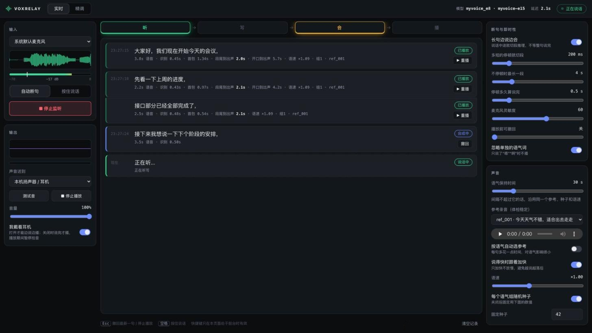

# VoxRelay

[中文](README.md) | English



A **real-time voice-changing workbench** built on [GPT-SoVITS](https://github.com/RVC-Boss/GPT-SoVITS). Speak into the microphone; VoxRelay transcribes the speech, re-speaks it in your trained voice, and plays it to your speakers, a virtual sound card, or a virtual sound card on another Mac in your LAN (for use as a meeting microphone).

```
mic → segmentation → ASR (Paraformer) → streaming TTS (GPT-SoVITS) → speakers / virtual device / remote virtual device
```

It is a speech → text → speech pipeline: expect 1.5–3 s of latency, and recognition errors are spoken as recognized. Chinese only for now. The UI and detailed docs are in Chinese.

## Features

- Long sentences are split at short pauses or a length limit and synthesized while you are still talking.
- Consecutive segments share one reference clip, seed and speed for a consistent tone.
- Automatic segmentation or push-to-talk; optional undo window; edit and resend text.
- Output to local speakers, a local virtual sound card, or (over SSH) a virtual sound card on another Mac.
- A tuning page that matches reference clips by prosody and ranks random takes.

## Compared with RVC real-time conversion

Both models were built from the same pool of about 20 minutes of phone voice messages (not identical training sets). 40 held-out utterances from a male speaker:

| Metric | RVC real-time | RVC offline | VoxRelay real-time |
|---|---|---|---|
| Character error rate, mean (lower is better) | 0.44 | 0.32 | **0.29** |
| Utterances with CER > 0.5 (of 40) | 13 | 8 | **7** |
| Speaker similarity, ERes2NetV2¹ | 0.74 | 0.80 | **0.84** |
| Pitch correlation with the source | **0.86** | 0.84 | 0.35 |
| Utterances with duration off by > 15% | 3 | **0** | 15 |
| Latency | **~0.5–0.6 s** | n/a | 1.6–2.9 s per segment |

VoxRelay is clearly more intelligible than the real-time RVC path here (the gap to offline RVC is not significant: −0.04, 95% CI −0.12 to +0.04). RVC keeps your intonation and timing far better and is much faster. For each RVC column the better of two transpose settings is shown. ¹ GPT-SoVITS v2Pro uses this speaker model itself, which favors VoxRelay. No listening test or MOS model was used. Full numbers and conditions are in the [Chinese README](README.md#与-rvc-实时变声对比).

## Requirements

macOS (developed on Apple Silicon M4, CPU inference), a working GPT-SoVITS install with pretrained and Chinese ASR models, your own trained GPT and SoVITS weights with their `.list` annotation file, `ffmpeg`, Chrome 110+, and Xcode Command Line Tools for remote output.

## Quick start

```bash
pip install -r requirements.txt       # in your GPT-SoVITS Python environment
cp config.example.json config.json    # set gpt_sovits_dir, ref_list, weights
./start.sh                            # then open http://127.0.0.1:9881/
```

If that environment is not your default `python3`, put `export VOXRELAY_PYTHON=/path/to/python` in `local.env`. All configuration fields are described in the [Chinese README](README.md#安装与配置).

## Remote output

Install a virtual sound card such as [BlackHole](https://github.com/ExistentialAudio/BlackHole) on the meeting computer, enable Remote Login there, then:

```bash
ssh-copy-id user@host
./start.sh check user@host
```

Choose "内网另一台 Mac" in the output menu, and select the virtual device as the microphone in your meeting app.

## Status

The remote path has been tested with a simulated SSH endpoint only, not yet on a real second machine. Local virtual-device output has not been verified on hardware either.

## Responsible use

Only use your own voice or voices you have explicit permission to use. Do not impersonate or deceive anyone, and disclose synthetic speech where law or context requires it.

## License

[MIT](LICENSE). No model weights or recordings are included. GPT-SoVITS, FunASR models and BlackHole are subject to their own licenses.
