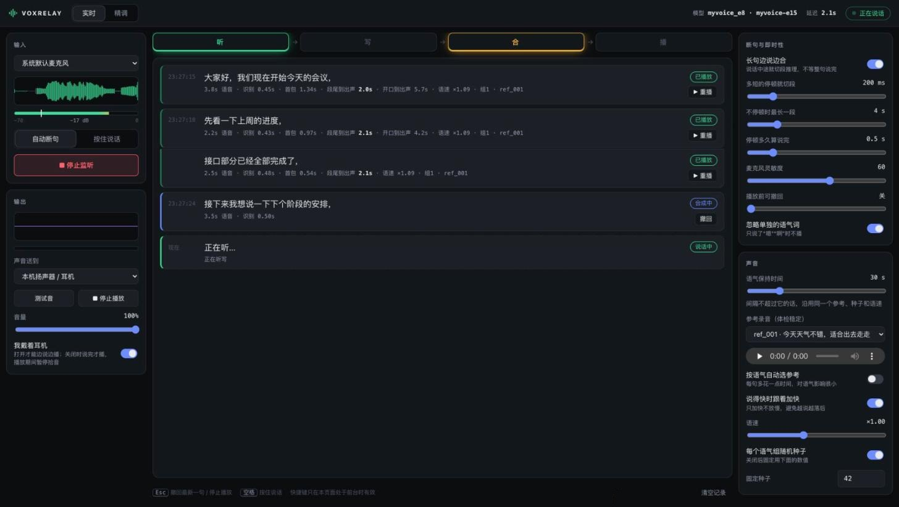
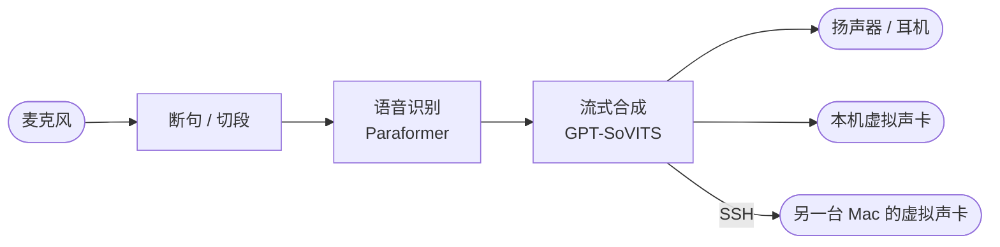
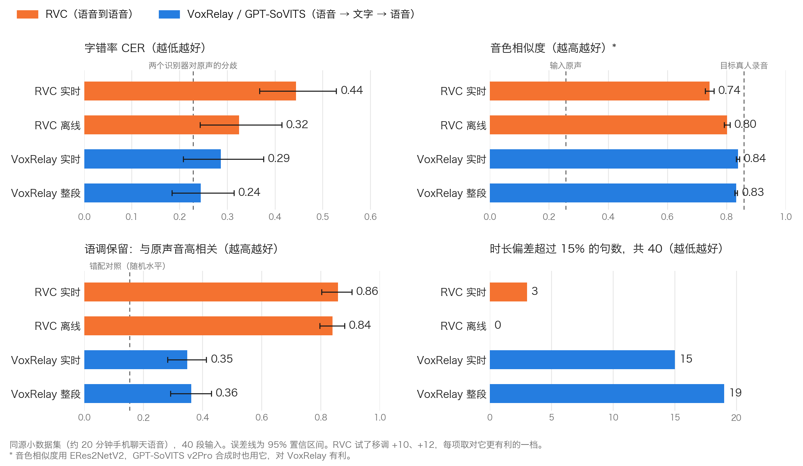

<div align="center">

# VoxRelay

**说话即变声：用你训练好的 GPT-SoVITS 音色，实时替你开口**


[功能](#功能) · [与 RVC 对比](#与-rvc-实时变声对比) · [安装](#安装与配置) · [输出到会议软件](#输出到会议软件) · [已知限制](#已知限制) · [English](README.en.md)



<sub>实时页。截图中的句子是示例内容，音色名与参考录音名已换成占位文字；延迟数字是当次实际运行结果。</sub>

</div>

对着麦克风说话，VoxRelay 实时识别成文字，用目标音色重新说出来，播放到扬声器、虚拟声卡，或内网另一台 Mac 的虚拟声卡（给腾讯会议等软件当麦克风）。



它是“语音 → 文字 → 语音”的方案：声音完全由目标音色模型生成。代价是有 1.5–3 秒延迟，识别错的字会照错的念出来，**语调也不跟随你的原话**。

## 功能

| | |
|---|---|
| ⚡ **边说边合** | 长句按短停顿或时长上限自动切段，不用等整句说完 |
| 🎯 **语气一致** | 同一句的各段，以及时间窗口内接着说的话，共用参考录音、种子和语速 |
| 🎙️ **两种触发** | 自动断句，或按住空格说话 |
| ✋ **可干预** | 可设播放前撤回窗口（默认关），`Esc` 撤回，点文字改错字重发 |
| 🔊 **三种输出** | 本机扬声器、本机虚拟声卡、经 SSH 写入内网另一台 Mac 的虚拟声卡 |
| 🎛️ **精调页** | 按语气匹配参考录音，单条合成对比，加权“抽卡”并自动打分排序 |

## 与 RVC 实时变声对比

**结论：** 在这组“约 20 分钟手机聊天语音”训练出的模型上，RVC 实时链路的**可懂度明显吃力**（40 句里有 13 句错字过半）；VoxRelay（GPT-SoVITS）的**可懂度和音色相似度更好**。但 **RVC 保留语调和时长远好于 VoxRelay，延迟也低得多**。两者各有胜负，按需要选。



### 完整数据

40 段输入（共 4.4 分钟男声朗读，两个模型都没训练过）。**加粗**为该行 RVC 与 VoxRelay 之间较好的一方。

| 指标 | RVC 实时 +10 | RVC 实时 +12 | RVC 离线 +10 | RVC 离线 +12 | VoxRelay 实时 | VoxRelay 整段 | 参照值 |
|---|---|---|---|---|---|---|---|
| 字错率 CER，均值 ↓ | 0.44 | 0.49 | 0.32 | 0.34 | 0.29 | **0.24** | 两个识别器对原声的分歧 0.23 |
| 字错率 CER，中位 ↓ | 0.36 | 0.42 | 0.24 | 0.28 | 0.21 | **0.20** | 同上 0.18 |
| 错字过半的句数（/40）↓ | 13 | 17 | 9 | 8 | 7 | **3** | 同上 3 |
| 音色相似度 ERes2NetV2 ↑ ¹ | 0.73 | 0.74 | 0.79 | 0.80 | **0.84** | 0.83 | 目标真人 0.86，输入原声 0.26 |
| 音色相似度 MFCC-GMM ↑ ² | −78.5 | −79.5 | −77.8 | −78.5 | **−74.5** | **−74.5** | 目标真人 −77.1，输入原声 −81.5 |
| 语调：与原声音高相关 ↑ | **0.86** | 0.84 | 0.84 | 0.83 | 0.35 | 0.36 | 错配对照 0.13–0.22 |
| 时长比（输出 / 原声），中位 | 0.93 | 0.93 | 0.97 | 0.97 | 1.02 | **1.01** | 1 |
| 时长偏差超过 15% 的句数 ↓ | 3 | 3 | **0** | **0** | 15 | 19 | |

| 延迟（另行测得，口径不同） | |
|---|---|
| RVC 实时 | 麦克风到输出约 **0.47 s**（本机回环）；经 Wi-Fi 约 0.6 s |
| VoxRelay | 每段说完到出声 **1.6–2.9 s**；连续说话时开口约 5.5 s 后首次出声 |

逐句配对比较（同一句输入，95% 置信区间）：

| 比较 | CER 差（负数 = VoxRelay 更好） | VoxRelay 更好 / 更差的句数 |
|---|---|---|
| VoxRelay 实时 − RVC 实时 +10 | −0.16 [−0.23, −0.08] | 29 / 6 |
| VoxRelay 实时 − RVC 离线 +10 | −0.04 [−0.12, +0.04]，**差异不显著** | 19 / 15 |
| VoxRelay 整段 − RVC 离线 +10 | −0.08 [−0.15, −0.01] | 26 / 13 |

语调相关一项，上述每组比较里 40 句至少有 39 句是 RVC 更高。

### 怎么选

| 你更在意 | 选择 |
|---|---|
| 对方听清楚在说什么、音色稳定像目标 | VoxRelay |
| 保留你自己的语气、节奏、笑声叹气 | RVC |
| 快速一来一往地对话 | RVC |

<details>
<summary><b>测试条件与局限（引用这些数字前请看）</b></summary>

- **训练数据同源但不完全相同。** 素材来自同一批 199 条原始手机语音。GPT-SoVITS：重新切分并用两个识别器交叉清洗，222 段、21.2 分钟；v2Pro，SoVITS 8 轮、GPT 15 轮。RVC：沿用旧切片中的 283 个，另加 7.4 分钟演唱录音，共 26.6 分钟；v2 40k，200 轮。因此比较的是作者实际训练出的这两套模型，**不能推广为两种架构的普遍结论**。
- **RVC 配置：** 检索索引 0.5；移调 +10 和 +12 都测了。实时：fcpe，块 0.2 s，左上下文 2.5 s，输入 DeepFilterNet3 降噪（与实际使用的实时服务同一套分块代码，批量生成时用 CPU）。离线：rmvpe，其余用 WebUI 默认值。没有做穷尽调参。
- **VoxRelay** 用与页面相同的断句、识别、标点和语气组规则离线批量生成，固定参考录音。
- **字错率**以 Whisper medium 对输入原声的识别结果为参照（不是人工标注），单条上限记 1。VoxRelay 的数值包含它自己识别阶段（Paraformer）的错误。
- ¹ ERes2NetV2 也是 GPT-SoVITS v2Pro 合成时使用的说话人模型，**对 VoxRelay 有利**。
- ² 与两套系统都无关的交叉检验；但 VoxRelay 得分高于目标真人录音，说明它也偏好平滑干净的声音，只宜看方向。
- 语调相关：提取音高后按频谱做时间对齐（DTW），只比较两边都有声的帧。
- **没有做主观听感测试，也没有用语音质量打分模型（MOS）**，所以这里不对“音质好坏”下结论。
- 只有一位说话人的朗读作输入、一个目标音色，样本量 40。

复现（用自己的模型和数据，汇总结果见 [`docs/comparison_summary.json`](docs/comparison_summary.json)）：

```bash
python scripts/compare_metrics.py --source 输入目录 --whisper medium.pt \
    --system "rvc=RVC输出目录" --system "vox=VoxRelay输出目录" --out result.json
```

另需 `openai-whisper`、`scikit-learn`、`opencc`。

</details>

## 环境要求

| 项目 | 说明 |
|---|---|
| 系统 | macOS（在 Apple Silicon M4、CPU 推理下开发和测试） |
| GPT-SoVITS | 单独安装，含 `GPT_SoVITS/pretrained_models`；按 commit `6d51ffc` 开发 |
| 识别模型 | GPT-SoVITS 的 `tools/asr/models` 下的中文 Paraformer、FSMN-VAD、标点三个模型 |
| 音色 | 你自己训练好的 GPT 与 SoVITS 权重（默认按 v2Pro），以及训练用的标注列表和录音 |
| 其他 | `ffmpeg`；Chrome 110 或更新版本 |
| 远程声卡 | 本机需要 Xcode Command Line Tools（用 `swiftc` 编译播放程序） |

目前只支持中文。

## 安装与配置

```bash
git clone <本仓库地址> voxrelay && cd voxrelay
# 在装好 GPT-SoVITS 依赖的 Python 环境里
pip install -r requirements.txt
cp config.example.json config.json
```

如果那个环境不是默认的 `python3`，新建 `local.env`（不进 git）：

```bash
export VOXRELAY_PYTHON=/path/to/env/bin/python
# 可选：缓存和临时目录放到别的盘
# export TMPDIR=/path/tmp HF_HOME=/path/tmp/hf
```

编辑 `config.json`。除 `cache_dir` 以本仓库为起点外，相对路径都以 GPT-SoVITS 目录为起点。

| 字段 | 含义 | 默认 |
|---|---|---|
| `gpt_sovits_dir` | GPT-SoVITS 目录（必填） | |
| `ref_list` | 参考录音列表（必填），GPT-SoVITS 标注格式 `音频路径\|说话人\|语言\|文本`；只用其中 3–10 秒的条目 | |
| `ref_base` | 列表里相对音频路径的起点 | 列表所在目录 |
| `gpt_weights` / `sovits_weights` | 音色权重；留空则读 GPT-SoVITS 的 `weight.json` | 留空 |
| `version` | 模型版本 | `v2Pro` |
| `realtime_ref` | 实时页默认参考的文件名 | 体检成绩最好的一条 |
| `default_ref` | 精调页的对比参考，`{"path": "...", "text": "..."}` | 无 |
| `base_rate` | 你的模型自然语速（字/秒），用于“说得快时跟着加快” | `3.8` |
| `device` | 推理设备；只测试过 `cpu` | `cpu` |
| `asr_dir` | 识别模型目录 | `tools/asr/models` |
| `cache_dir` | 缓存目录 | `.cache` |
| `port` | 页面端口；远程声卡通道用 `port + 1` | `9881` |
| `remote` | 远程电脑默认值，`{"target": "用户名@地址", "device": "BlackHole 2ch"}` | |

## 运行

```bash
./start.sh
```

浏览器打开 <http://127.0.0.1:9881/>，点“开始监听”。首次启动要为参考录音建立语气索引，需要几分钟。

### 可选：参考录音体检

不同参考录音的合成稳定性差别很大。服务运行时另开一个终端：

```bash
python scripts/audit_refs.py   # 用与服务相同的 Python 环境
```

它让每条参考合成 3 个句子再识别回来，之后实时页只列出稳定的参考。耗时较长，可以中断后续跑。

## 输出到会议软件

虚拟声卡有一个输出端和一个直通的输入端：VoxRelay 往输出端播放，会议软件把输入端当麦克风读取。推荐 [BlackHole](https://github.com/ExistentialAudio/BlackHole)：

```bash
brew install blackhole-2ch
```

### 本机虚拟声卡

页面左下“声音送到”选 **本机虚拟声卡**，选 BlackHole；会议软件的麦克风也选它。

### 内网另一台 Mac

开会的电脑需要：开启“系统设置 → 通用 → 共享 → 远程登录”，并装好虚拟声卡。本机需要能免密登录它：

```bash
ssh-copy-id 用户名@内网地址
./start.sh check 用户名@内网地址     # 逐步检查登录、拷贝程序、声卡、播放
./start.sh
```

页面上“声音送到”选 **内网另一台 Mac**，填地址，点“开始监听”。对方会议软件的麦克风选虚拟声卡，**扬声器不要选它**。

链路：浏览器 →（本机 WebSocket）→ 服务 →（SSH）→ 对方的播放程序 → 虚拟声卡。第一次连接会把约 200 KB 的播放程序拷到对方的 `~/.voxrelay/`。程序只改变自己的输出设备，不动对方的系统默认声卡；找不到指定设备时直接报错，不会改用扬声器。内网上不需要新开端口。

## 使用提示

| 设置 | 作用 |
|---|---|
| 多短的停顿就切段 / 最长一段 | 越短越快出声，识别错误略多 |
| 停顿多久算说完 | 判定一句话结束 |
| 语气保持时间 | 间隔不超过它的话沿用同一参考、种子和语速 |
| 我戴着耳机 | 用扬声器外放时关闭：说完才播，播放期间暂停拾音，避免录到自己。输出到虚拟声卡或远程电脑时不需要 |

会议用的电脑如果外放且离你的麦克风很近，别人说的话可能被识别后发回会议，请戴耳机。

## 性能

Mac mini（M4，CPU 推理），一个 v2Pro 音色，用训练录音模拟麦克风输入。换机器和音色结果会不同。

| 指标 | 数值 |
|---|---|
| 单段识别 | 约 0.45–0.8 s |
| 流式合成首包 | 约 0.65–1 s |
| 每段“段尾到出声” | 约 1.6–2.9 s，排队时可到 4 s |
| 连续说话时首次出声 | 开口后约 5.5–6 s |
| 长句错字率（整句 → 切段） | 2.4% → 3.6% |
| 段间音高波动（随机参考 → 共用参考） | 0.80 → 0.34 半音 |
| 说话人相似度（随机参考 → 共用参考） | 0.731 → 0.863 |

## 已知限制

- **语调和节奏不跟随原话**：合成语气由参考录音和模型决定，逐句时长也可能明显偏长或偏短（见上面的对比）。
- 远程声卡链路只用模拟的 `ssh` 测过协议和页面流程，**尚未在真实的第二台机器上验证**出声和延迟。
- 本机虚拟声卡输出尚未实机验证；断句参数尚未用多种真实麦克风和噪声环境验证。
- 强制切段可能切在词中间。
- 开启“边说边合”时，只要最后一段语音超过约 1.5 秒，它会在短停顿处提前发出，按“还没说完”的语调（逗号）合成；很短的句子才是正常的句末语调。关闭该开关可避免，但要等整句说完才出声。
- 快捷键只在页面处于前台时有效。
- 远程目标只支持 macOS。

## 安全

服务只监听 `127.0.0.1`，没有登录机制。HTTP 请求校验 `Host` 头，远程声卡通道只接受本页面来源的 WebSocket 连接，SSH 地址按固定格式校验。请不要用反向代理把它暴露到网络上。

## 测试

```bash
python tests/test_relay.py        # 远程通道（假 ssh，不需要模型和声卡）
node tests/test_segmenter.mjs     # 断句器
```

## 使用须知

请只使用你本人的声音，或已获得明确授权的声音。不要用它冒充他人、欺骗或误导；在会议或通话中使用合成声音时，请按当地法律和场合要求告知对方。

## 致谢与许可

- [GPT-SoVITS](https://github.com/RVC-Boss/GPT-SoVITS)（MIT）：语音合成。`voxrelay/voice_convert.py` 调用其内部接口。
- [FunASR](https://github.com/modelscope/FunASR) Paraformer：语音识别，模型遵循其各自许可。
- [BlackHole](https://github.com/ExistentialAudio/BlackHole)：虚拟声卡，需单独安装，本仓库不包含。

本仓库代码以 [MIT](LICENSE) 许可发布。仓库不包含任何模型权重或录音。
